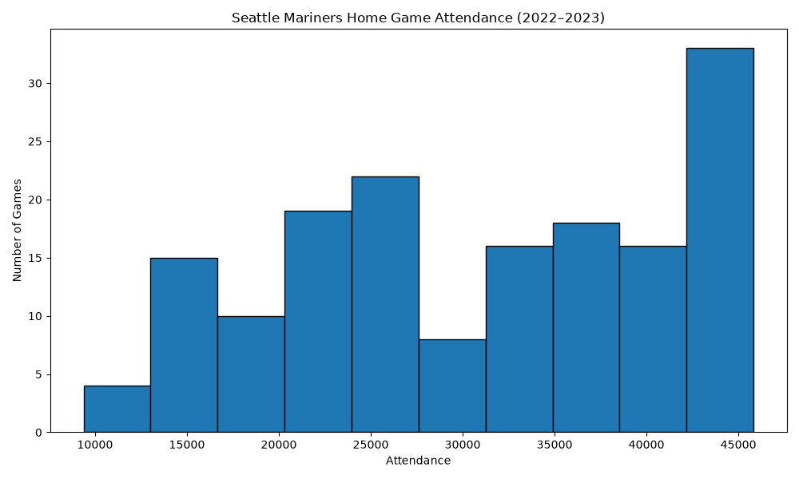
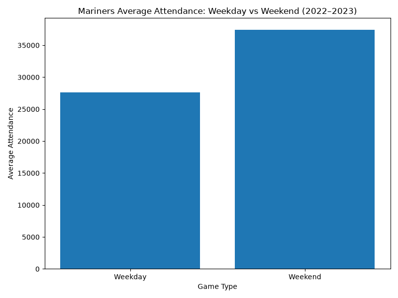
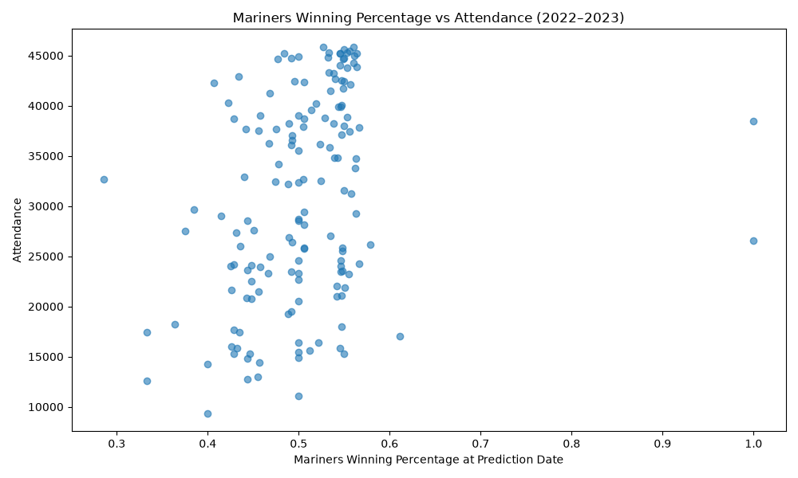

# Seattle Mariners Attendance Prediction: Model Report

## 1. Exploratory Analysis

This project uses 323 Seattle Mariners home games from 2022–2025 to predict attendance seven days before each game. The data was divided chronologically into 161 training games (2022–2023), 81 validation games (2024), and 81 test games (2025). Exploratory analysis used only the training data.

### Attendance Distribution

Attendance varied substantially, with concentrations around 20,000–27,000 and 40,000–46,000 fans, suggesting that a single average does not adequately represent attendance across all games.

### Weekend vs. Weekday Attendance

Weekend games averaged 37,386 attendees compared with 27,653 for weekday games, a difference of 9,733 fans (35.2%), suggesting that weekend scheduling is an important predictor.

### Mariners Winning Percentage vs. Attendance

Higher winning percentages were generally associated with higher attendance, although substantial variation and a few early-season outliers suggest that team performance alone cannot reliably predict attendance.

## 2. Evaluation Method and Baseline

Mean Absolute Error (MAE) was selected because attendance is numerical, and MAE measures the average absolute difference between predicted and actual attendance in fans. Lower MAE indicates better predictive accuracy.

The baseline predicted the training average of 30,917 fans for every 2024 validation game. This produced a validation MAE of 6,725 fans.

## 3. Model Comparison

Three regression models were trained using 2022–2023 observations and evaluated on the 2024 validation games.

| Model | Validation MAE (Fans) |
|---|---:|
| Baseline (Training Average) | 6,725 |
| Linear Regression | 6,812 |
| Decision Tree | 6,318 |
| **Random Forest** | **5,790** |

Random Forest achieved the lowest validation MAE, improving prediction accuracy by approximately 13.9% compared with the baseline. Linear Regression performed slightly worse than the baseline, while Decision Tree provided a modest improvement.

## 4. Selected Model and Feature Importance

Random Forest was selected because it had the lowest validation MAE of 5,790 fans. Its 2025 test MAE was 6,166 fans, approximately 6.5% higher than validation. This suggests reasonably consistent performance across the two seasons, although prediction errors remain substantial.

The four most important individual predictors were:

| Feature | Importance |
|---|---:|
| Weekend scheduling | 26.3% |
| Month | 21.3% |
| Previous five-game attendance average | 19.4% |
| Mariners winning percentage | 12.3% |

Weekend scheduling was the strongest individual predictor, consistent with higher weekend attendance. Month captured seasonal patterns, while recent attendance provided information about historical demand. Winning percentage also contributed, suggesting that team performance helps explain attendance variation. These relationships are useful for forecasting but do not establish causation.

## 5. Business Implications and Limitations

The model could help the Mariners forecast attendance seven days before home games, supporting staffing, concession inventory, security, and other operational decisions. Better forecasts could reduce unnecessary costs and improve preparation for high-demand games.

However, the test MAE of 6,166 fans indicates substantial uncertainty. The dataset covers only four seasons and excludes promotions, ticket prices, advance ticket sales, and other potential demand factors. Early-season missing values were replaced using training-data averages, which may reduce accuracy.

Future improvements could incorporate promotional schedules, advance ticket sales, and ticket pricing information available before the seven-day prediction cutoff.
